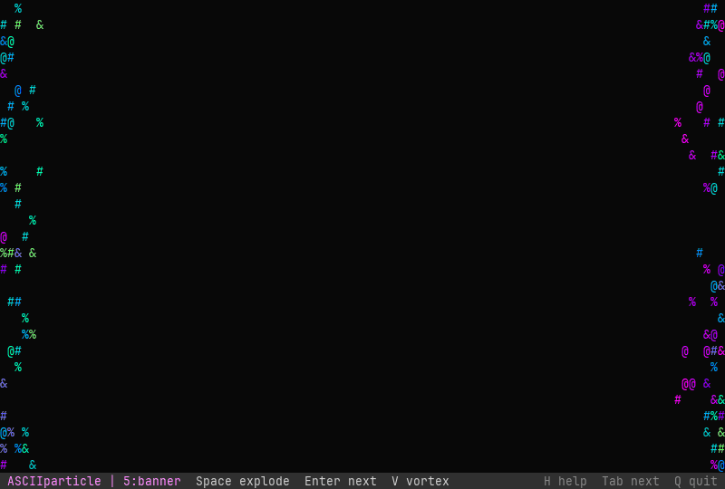

# ASCIIparticle

A small game engine for the terminal, built around **particles** and **ASCII sprites**.
It runs in macOS Terminal.app and iTerm2 with nothing to install: pure Python standard
library, Python 3.9+ (the `python3` that ships with Apple's Command Line Tools works).



<sub>Recorded headless by the engine itself (`--reel`). Higher quality: [docs/demo.mp4](docs/demo.mp4).</sub>

## Play

```sh
git clone https://github.com/BaruaSourav/ASCIIparticle.git
cd ASCIIparticle
python3 -m asciiparticle
```

Or double-click **`play.command`** in Finder. It opens Terminal at 110×34 and starts the game.

A window of at least 80×24 looks best. Every scene adapts when you resize the window.

| Key | Everywhere |
| --- | --- |
| `1`–`5` | jump to a scene |
| `Tab` | next scene |
| `H` / `?` | help for the current scene |
| `P` | pause |
| `Q` / `Esc` | quit |

### Scenes

1. **Meadow (the game).** Catch as many fireflies as you can in 60 seconds. The wind
   rolls across the grass in gusts and carries leaves and petals. Your steps push
   the grass aside.
   `←/→` or `A/D` walk · `↑`/`W`/`Space` jump · `E` wind spell · `G` big gust · `R` restart.
   After 25 seconds with no input the game plays itself until you press a key.
   `python3 -m asciiparticle --demo` starts it in that mode.
2. **Ink Flow.** Dense neon particles poured into curl-noise currents around a vortex,
   with ink drips.
   `Space` reverse swirl · `C` palette · `G` glyph set (try `CRAWL`) · `←/→` swirl strength · `D` drips.
3. **Fireworks.** Peonies, rings, willows, palms and crackles over a city skyline.
   `Space` launch · `A` auto-launch · `←/→` wind.
4. **Campfire.** Fire, smoke and embers in the wind, with weather.
   `Space` stoke · `R` rain · `S` snow (it settles) · `L` lightning · `←/→` wind.
5. **Banner.** Words made of spring-loaded particles.
   `Space` blow them apart · `Enter` next phrase · `V` vortex · `←/→` wind.

### Terminal tips (macOS)

- Terminal.app and iTerm2 both support the 256-colour palette the engine uses.
  Any monospaced font works. Menlo and SF Mono look good.
- Terminals report key presses, not key releases. A key counts as held for a moment
  after each press, and macOS key-repeat keeps it held. If walking stutters, shorten
  **System Settings → Keyboard → Delay until repeat**.

## Make your own

```python
from asciiparticle import (Emitter, Engine, Frame, GrassField, Noise,
                           ParticleSystem, Scene, Sprite, WindField)

CAT = Frame.from_art(r"""
 /\_/\
( o.o )
 > ^ <
""", colors="""
 yyyyy
yyggyyy
 yyyyy
""", palette={"y": 215, "g": 46}, solid=True)


class Garden(Scene):
    name = "garden"

    def setup(self):
        self.wind = WindField(Noise(1), base=5.0, gust=8.0)
        self.grass = GrassField(self.rng, self.width, self.height - 2)
        self.fx = ParticleSystem(self.rng, wind=self.wind)
        self.leaves = self.fx.add(Emitter(
            x=self.width / 2, y=0, rate=6, shape="line", width=self.width,
            life=(4, 7), speed=0, chars="',.", colors=[148, 112, 70], wind=1.5, gravity=1.0))
        self.sparkles = self.fx.attach(Emitter(
            life=(0.4, 1.0), speed=(5, 14), chars="*+.", colors=[231, 229, 220, 214], gravity=10))
        self.cat = Sprite(CAT)
        self.x = self.width / 2

    def update(self, dt):
        if self.input.held("left"):
            self.x -= 15 * dt
        if self.input.held("right"):
            self.x += 15 * dt
        if self.input.pressed("space"):
            self.sparkles.emit(40, self.x, self.height - 4)
        self.grass.disturb(self.x, 3, 0.4)
        self.wind.update(dt, self.width)
        self.grass.update(dt, self.wind)
        self.fx.update(dt)

    def draw(self, canvas):
        self.grass.draw(canvas)
        self.cat.draw(canvas, self.x, self.height - 2)
        self.fx.draw(canvas)


Engine([Garden]).run()
```

The full version is in [`examples/minimal.py`](examples/minimal.py). Run it with
`python3 examples/minimal.py`.

### What's in the engine

| Module | What it does |
| --- | --- |
| `engine.py` | `Engine` runs a fixed-timestep loop, headless or in a terminal. It handles scene switching, the status bar, help and pause. `Scene` gives you `setup / resize / update / draw / hud` hooks plus `after()` and `every()` timers. `Entity` and `overlaps()` handle positions and hit boxes. |
| `particles.py` | `ParticleSystem` and `Emitter`. Emitters have rate or burst spawning, point / line / rect / circle shapes, glyph and colour ramps by life, randomly or by direction, gravity, drag, wind coupling, floor collision (die or bounce) and `on_spawn` / `on_death` hooks for chains such as rocket → burst → crackle. |
| `forces.py` | `WindField` (gusts that roll downstream), `Vortex`, `Attractor`, `HomeSpring` (particles that return to a target), and `FlowField` (curl-noise currents). |
| `grass.py` | `GrassField` gives one damped-spring blade per column. Blades lean in the same `WindField` the particles feel, and `disturb()` pushes them for footsteps and spells. |
| `sprite.py` | `Frame.from_art` builds sprites from ASCII art plus a colour mask. It supports transparency, `solid` fill, mirroring (`/` ↔ `\`, `(` ↔ `)`…), named `Animation`s and the `Sprite` play head. |
| `canvas.py`, `terminal.py`, `input.py` | The cell buffer, a diffing ANSI renderer (only changed cells are written), raw-mode keyboard input and held-key emulation. |
| `font.py` | A 5×5 block font that turns text into particle targets. |
| `export.py`, `reel.py` | A headless renderer to GIF and MP4, and the scripted demo reel. |

Colours are xterm-256 indices. Use `rgb(r, g, b)`, `hex_color("#ff00aa")` and
`gradient([...], n)` to build ramps.

## Record a video

Recording needs Pillow (`python3 -m pip install pillow`). MP4 also needs ffmpeg
(`brew install ffmpeg`).

```sh
python3 -m asciiparticle --reel docs/demo.gif docs/demo.mp4 --size 100x30 --font-size 13
python3 -m asciiparticle --record fireworks.gif --scene fireworks --seconds 8
python3 -m asciiparticle --record meadow.mp4 --scene meadow --demo --size 120x36
```

Recordings are deterministic. The same `--seed` always gives the same video.

## Tests

```sh
python3 -m unittest discover -s tests
```
